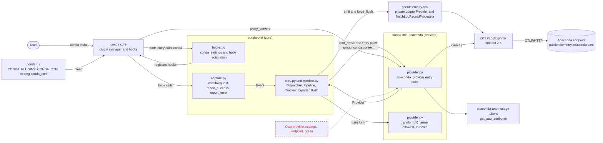
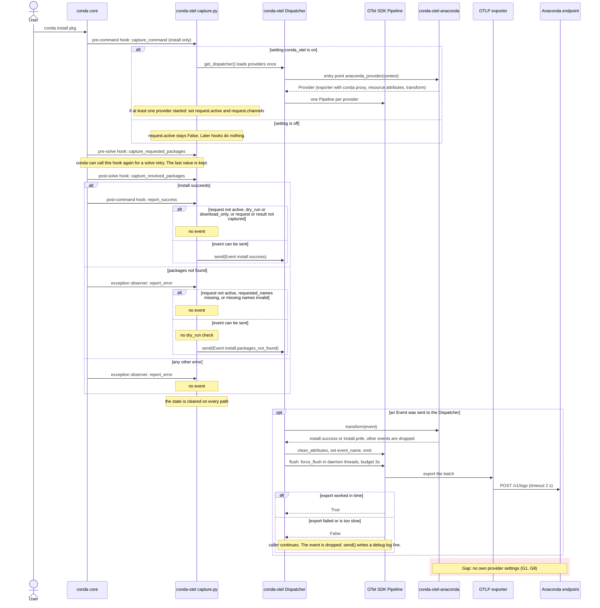

# Architecture of conda-otel and conda-otel-anaconda

## 1. Overview

`conda-otel` is a conda plugin. Its hooks for `conda install` collect the channels, requested packages and resolved packages into a vendor-neutral `Event`. It sends the event to every installed provider package. A provider registers in the entry-point group `conda_otel.providers`, converts the event to its own format and supplies an OpenTelemetry exporter. `conda-otel-anaconda` is the Anaconda provider. It converts events to `install.pnfe` and `install.success` signals and sends them by OTLP/HTTP to `https://public.telemetry.anaconda.com/v1/logs`.

## 2. Component diagram

Legend: a red dashed box marks something missing, stubbed or unresolved. Dashed arrows connect to such a box.

## 3. Sequence diagram

Legend: a red block marks steps with unresolved gaps.

## 4. Data flow

The skeleton sends a reduced payload. The full contract is `schema/signal_schema.json` in `conda-anaconda-telemetry`. Every row below goes to the Anaconda endpoint.

| Data | Source | Transformation |
|---|---|---|
| Channels | `context.channels` in the pre-command hook, for both events | `conda-otel`: none. Provider: maps to `defaults`, `main`, `main-x`, `conda-forge`, otherwise `other`. Cut to 50 items and 500 bytes. Sent as `install.channels`. |
| Channel priority | `context.channel_priority` | `str()`. Sent as `install.channel_priority`. |
| Requested packages | `specs_to_add` in the pre-solve hook | `package_names()`: exact names only, sorted. `None` if a spec is a URL, is invalid, or has a name outside `[a-z0-9_.-]`. In that case no event is sent. Provider cuts the list. Sent as `requested.packages`. |
| Resolved packages | `link_precs` in the post-solve hook | `name=version=build` strings. Provider cuts the list. Sent as `resolved.packages`. |
| Missing packages | `PackagesNotFoundInChannelsError.packages` | `package_names()`. Provider cuts the list. Sent as `exception.missing_specs`. |
| Exception name | `event.exc_type.__name__` | None. Sent as `exception.name`. |
| Command | Fixed string `install` | None. Sent as `command`. |
| Event name | `EventName` in `capture.py` | Provider maps to `install.pnfe` or `install.success`. The provider adds it as the attribute `log.event.name`. `Pipeline.emit` sets it as the `event_name` field of the log record. It is also the log record body. |
| Truncated flag | Provider, `truncate()` | `True` if any list was cut. Sent as `truncated`. |
| Schema version | `SIGNAL_VERSION` in `provider.py` | Sent as `event.schema_version`. |
| Resource attributes | `anaconda_provider()`: `service.name`, `service.version`, `platform` (`conda`), `os.type` (`platform.system()`), `python.version`, `client.sdk.version` (provider version), `schema.version` (`RESOURCE_SCHEMA_VERSION`, `0.1.0`), `parameters` (`{}`) | `Resource.create()` adds `telemetry.sdk.language`, `telemetry.sdk.name` and `telemetry.sdk.version`. Set once on the provider's `LoggerProvider`. |
| aau tokens | `get_aau_attributes()`: the eight token functions of `anaconda-anon-usage` | `str()`. Lists become JSON strings. A token that is `None` is left out. Sent as `aau.*` resource attributes. |

Every event attribute passes `clean_attributes()` in `core.py`. It keeps scalars and lists of one scalar type.

## 5. Decisions in the skeleton

D1: the skeleton drops a delivery that takes too long. It uses no background process and no disk queue. A background process can outlive the conda environment it runs from, and it shows in the process list. A disk queue keeps unredacted data on disk, and channel URLs can contain tokens. The user waits at most three seconds and sees no terminal output.

- `TrackingExporter` in `pipeline.py` records the result of each export. `Dispatcher.flush` returns `True` for a provider only if the flush finished in time and the last export did not fail.
- `send` in `capture.py` writes a debug log line for each provider that did not get the event.
- `pipeline.py` adds a `NullHandler` to the `opentelemetry` logger and sets `propagate = False` on it. Python prints records that have no handler, and conda prints root logger records to stderr.

## 6. Gaps and open questions

"Core" means [`conda-otel`](https://github.com/lrandersson/conda-otel). "Provider" means [`conda-otel-anaconda`](https://github.com/lrandersson/conda-otel-anaconda).

| # | Gap or open question | Why |
|---|---|---|
| G1 | A provider gets the whole conda `context` but has no setting of its own (endpoint, opt-in). The `endpoint` argument of `anaconda_provider` is only used by tests. | Only a conda plugin can add a conda setting, and a provider is not one. `conda-otel` could add its own extension point so that providers become conda plugins. A manual test with `conda 26.7.2` and two small stand-in packages showed this works. The actual packages were not tested. The skeleton does not use this extension point. |
| G2 | The provider uses the conda setting `proxy_servers`. An `HTTP_PROXY` environment variable wins over it (`requests` behavior). One test covers the conda setting. No test covers the environment variable. | Users behind a proxy need this, because `conda-anaconda-telemetry` passes it to the wrapper. No data was sent through an actual proxy server. Proxies that re-sign HTTPS traffic may also need the conda setting `ssl_verify`, which the provider does not read. |
| G3 | Only `install` is captured. The command name is fixed, and `create` events are not sent. | The spike is a proof of concept. Other commands can be added when needed. |
| G4 | Only `--dry-run` and `--download-only` are handled. Other flags have not been investigated. | These are the flags that `conda-anaconda-telemetry` handles. Other flags can change what a "successful install" means. |
| G5 | An event that takes longer than the exporter timeout (2 s) is lost. Nothing sends it later. An unreachable endpoint delays every `conda install` by up to 3s (flush budget). | See D1. |
| G6 | The code uses the private `opentelemetry.sdk._logs` API. `conda-otel` pins `opentelemetry-sdk` to `>=1.40,<1.44`, and the unit tests ran only with 1.40.0 and 1.43.0. | A new SDK release can change or remove the private classes. The pin limits the risk but gives no fallback. |
| G7 | The request state is a module-global object. | conda runs one command per process. The object is not safe for threads or for conda used as a library. |
| G8 | A provider has no opt-in of its own. If a provider is installed, it is on by default. | The setting `conda_otel` turns off all providers. A per-provider opt-in needs a provider setting (G1). |
| G9 | Open question: `OTEL_SDK_DISABLED` is ignored on purpose. Should a user be able to turn the plugin off with it? | Core hides all `OTEL_*` variables so that a user setting cannot change where data goes. The standard off switch does not work. An end-to-end check confirmed this: 18 `OTEL_*` variables set at once did not change the payload, and `OTEL_SDK_DISABLED=true` did not stop the event. |
| G10 | No privacy review. Core gives channels, package names, channel priority and the exception name to every provider without redaction. | Each provider must redact for itself. A provider with weaker rules would send more than intended. |
| G11 | No conda package was built. Other operating systems and Python versions were not tried. | The wheels were built and installed in a temporary environment, and `conda install` ran against a local OTLP server there. The tests run from the source tree on Linux with Python 3.11. `aau.anaconda_auth.token` was not tested, because no signed-in user was available. |
| G12 | Delivery over a network outside the local machine was not measured. | The tests and the end-to-end runs use a local server. |
| G13 | The skeleton sends a reduced payload compared with `conda-anaconda-telemetry`. | The attributes `conda.version`, `conda.ci_detected`, `os.version`, the installer attributes, `environment` and `service.instance.id` are not sent. The baseline payload is not agreed. |
| G14 | The not-found event uses the configured channels. The older plugin uses the canonical channel names from the error. | Both events now have the same channel form. The canonical form removes a token from a channel URL but keeps private channel names. The configured form can keep a token, so each provider should redact it. |
